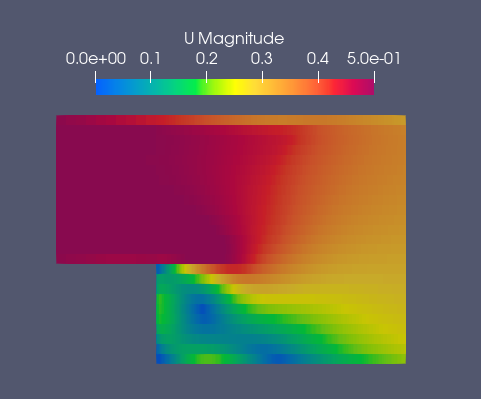
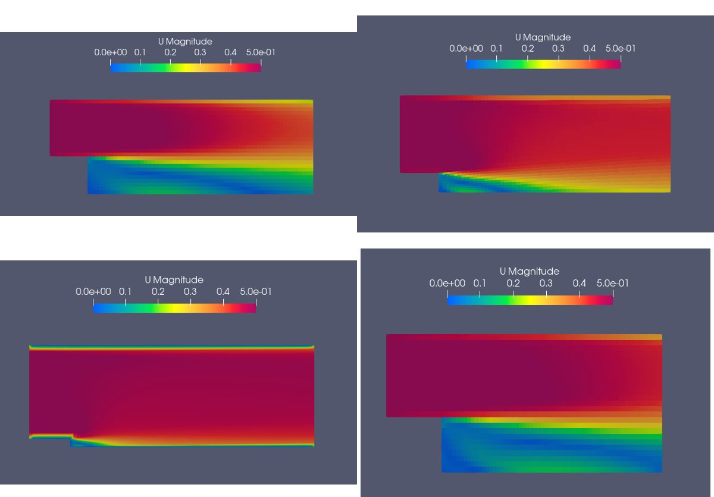
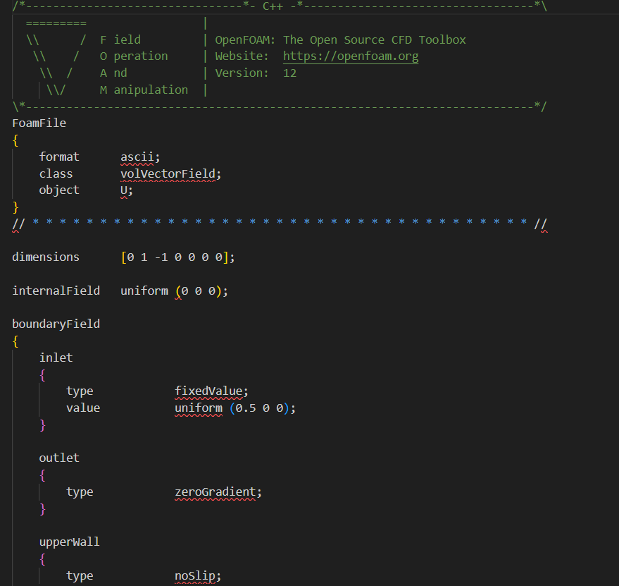
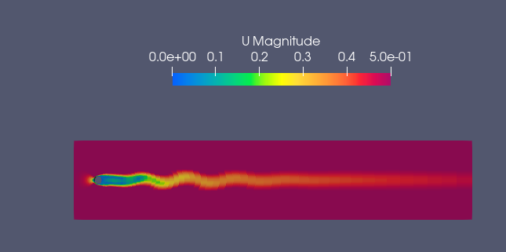
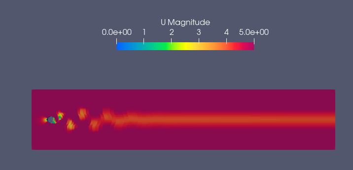
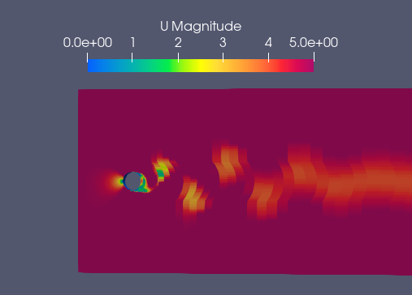
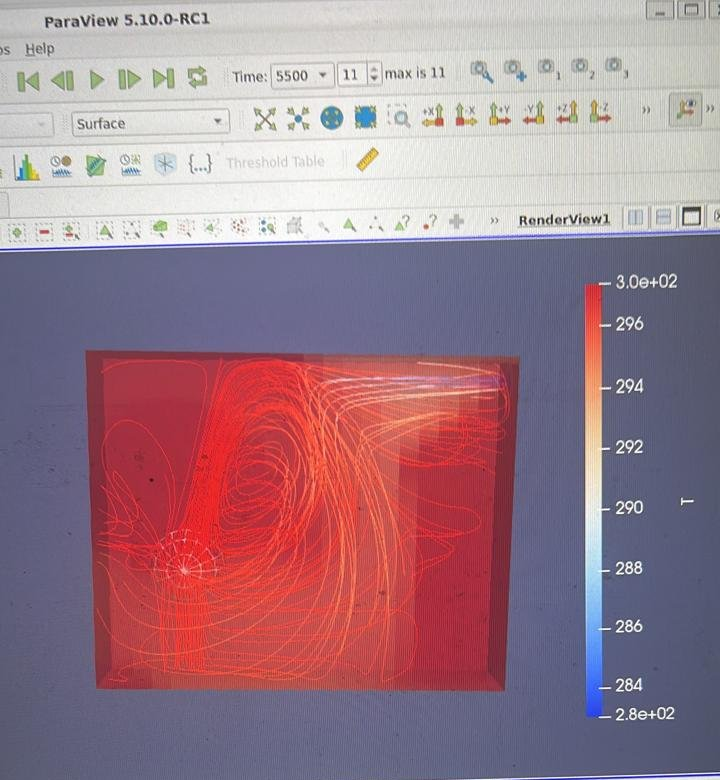

# 💨 OpenFOAM CFD Simulations

Computational Fluid Dynamics cases I set up, ran and post-processed in **OpenFOAM** and **ParaView**, mostly as part of the *Computational Fluid Dynamics* course at Pontificia Universidad Católica de Chile (2024). The course work fed directly into my thermal study for the RobotX sensor housings.

| Case | Physics | Highlights |
|---|---|---|
| [Backward-facing step](#1-backward-facing-step) | Incompressible internal flow | Flow separation and recirculation downstream of a step, several configurations |
| [Flow past a cylinder](#2-flow-past-a-cylinder) | Incompressible external flow | Wake development and vortex shedding (von Kármán street) |
| [RobotX sensor housing](#3-robotx-sensor-housing-thermal-study) | Heat transfer | Internal air circulation and temperatures in a sensor housing |

---

## 1. Backward-facing step

A classic validation case: flow enters a channel that suddenly expands, separates at the corner and reattaches downstream. I ran several configurations to see how the recirculation zone changes.

  
  

Case setup follows the standard OpenFOAM structure (`0/`, `constant/`, `system/`), with Newtonian transport properties for water and no-slip walls:

  

## 2. Flow past a cylinder

At moderate Reynolds numbers, the wake behind a cylinder becomes unstable and sheds vortices alternately from each side. I compared a low-velocity case with higher-velocity cases where the shedding is clearly visible.

  
  

  

A 3D turbulent (URANS) version of this flow later became the data source for my [physics-informed neural network project](https://github.com/fdosaavedra/pinn-navier-stokes-surrogate).

## 3. RobotX sensor housing thermal study

The LiDAR and camera housings on our RobotX catamaran were overheating (up to 120 °C). I modeled the air inside a housing with a heat source to understand how the air circulates and where heat accumulates. The streamlines show how the air recirculates inside the housing, which helped guide the redesign with cutouts and heat fins.

  

The redesigned housings brought peak temperatures down to 85 °C. Full story in [robotx-caleuche-mechanical](https://github.com/fdosaavedra/robotx-caleuche-mechanical).

---

## 🧰 Tools

